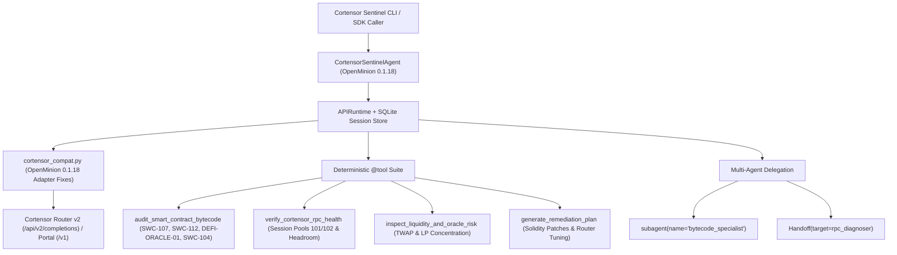

# Cortensor Sentinel (`cortensor-sentinel`)

**On-Chain & DeFi Smart-Contract Risk & Cortensor RPC/Router Health Verifier Agent built on the OpenMinion 0.1 Python SDK (`openminion==0.1.18`)**

Built for **Cortensor Hackathon #5** (`https://dorahacks.io/hackathon/2418/detail`).

---

## Overview

**Cortensor Sentinel** is a local-first, inspectable security auditing and decentralized node verification agent built on **OpenMinion 0.1.18** and **Cortensor Router v2 / Cortensor Portal**. It combines deterministic static smart-contract vulnerability analysis and Cortensor session-pool diagnostics with OpenMinion's typed `Agent`, `APIRuntime`, `@tool`, `subagent`, `Handoff`, durable SQLite sessions, and streamed turn handles.

### OpenMinion 0.1 Building Blocks Exercised

| OpenMinion Building Block | Implementation in Cortensor Sentinel |
| :--- | :--- |
| **`APIRuntime` & `OpenMinionConfig`** | Single-process embedded runtime (`src/cortensor_sentinel/cortensor_compat.py`, `src/cortensor_sentinel/agent.py`) with configured `sentinel` and `rpc_diagnoser` agent profiles. |
| **Cortensor Provider (`cortensor-router` & `cortensor-portal`)** | Full support for `/api/v2/completions` (`cortensor_completion` mode), session pool failover (`dedicated_session_ids=[101, 102]`, `ephemeral_session_ids=[204]`), and off-chain `urn:blob` pending polling. |
| **Structured `@tool` & `forced_tools`** | 4 deterministic `@tool` functions (`audit_smart_contract_bytecode`, `verify_cortensor_rpc_health`, `inspect_liquidity_and_oracle_risk`, `generate_remediation_plan`) in `src/cortensor_sentinel/tools.py`. |
| **Typed Output Validation (`output_type`)** | Strict Pydantic v2 `ContractRiskReport` schema validation (`src/cortensor_sentinel/schemas.py`) with retry on `AgentOutputValidationError`. |
| **Error & Resilience Handling** | Automatic retry and deterministic static fallback across `ProviderError` (`RATE_LIMITED`, `TIMEOUT`, `AUTH_ERROR`), `TurnTimeoutError`, and `AgentOutputValidationError`. |
| **Delegation (`subagent` & `Handoff`)** | Bounded `subagent(parent, name="bytecode_specialist", timeout_seconds=60)` and peer `Handoff(target=diagnoser)` (`transfer_to_rpc_diagnoser`). |
| **Durable Sessions & Streaming** | Multi-turn SQLite session continuity verified via `openminion.api.queries.runs.list_runs` and streamed chunk iteration via `APIRuntime.submit_turn()` / `RuntimeTurnHandle`. |
| **SDK Bug Reports & Runtime Fixes** | 8 real `openminion==0.1.18` findings documented in [`SDK_FEEDBACK_AND_BUGS.md`](SDK_FEEDBACK_AND_BUGS.md), reproduced in [`tests/test_sdk_bugs_repro.py`](tests/test_sdk_bugs_repro.py), and patched in [`src/cortensor_sentinel/cortensor_compat.py`](src/cortensor_sentinel/cortensor_compat.py). |

---

## Architecture



---

## Quick Start & Reproducible Verification

### 1. Setup Virtual Environment & Install

```bash
cd cortensor-openminion-hackathon
uv venv .venv
uv pip install --python .venv/bin/python openminion pytest httpx pydantic rich
uv pip install --python .venv/bin/python -e . --no-deps
```

### 2. Run the Automated Test Suite (12/12 Tests)

```bash
.venv/bin/pytest -v
```

### 3. Run the Live End-to-End Demo

```bash
.venv/bin/python -m cortensor_sentinel.cli --mode demo --export-log logs/sample_execution.log
```
